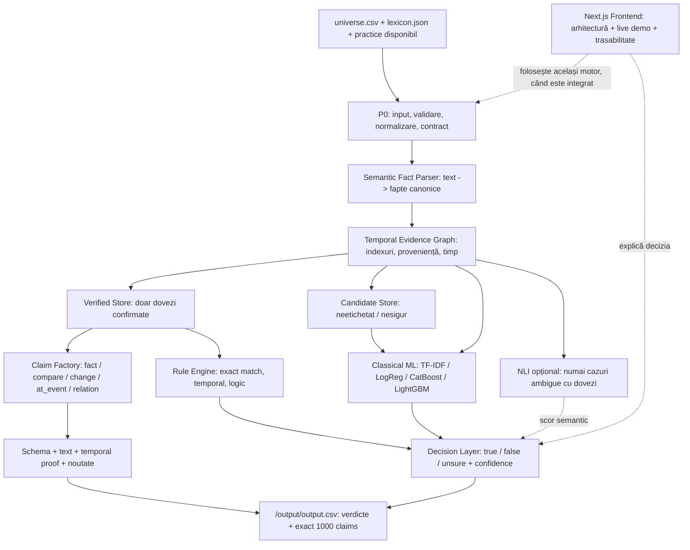

# NEURON 5 — Context complet al proiectului și arhitectura soluției

**Proiect:** QA DNA Hype Arena — NEXXT AI Hackathon 2026  
**Echipă:** NEURON 5  
**Stadiu documentat la:** 28 octombrie 2026  
**Scopul documentului:** handoff tehnic pentru un coleg, evaluator, nou chat ChatGPT sau agent Codex.  
**Nota de interpretare:** separăm explicit **cerințele oficiale**, **implementarea observată în repository**, **benchmarkurile furnizate** și **arhitectura țintă propusă**. O componentă descrisă ca *planificată* nu trebuie prezentată drept implementată sau validată.

## 1. Rezumat executiv — ideea în 90 de secunde

Construim un **Evidence-First Hybrid Truth Engine** care clasifică afirmații despre o companie fictivă, *Hooly*, folosind fapte structurate, dovezi cu proveniență, reguli temporale și modele de machine learning clasice. Un modul NLI cu encoder compact poate fi folosit doar pentru cazuri ambigue, dacă benchmarkurile îi demonstrează utilitatea pe 2 CPU. Separat, un **Claim Factory** determinist trebuie să genereze exact 1.000 de afirmații noi, adevărate, demonstrabile și conforme cu reguli stricte de text și JSON.

Soluția urmărește două rezultate independente, livrate în același CSV:

1. Clasifică aproximativ **18.000 de afirmații neetichetate** ca `true`, `false` sau `unsure`.
2. Generează **exact 1.000 de noi claims** valide și adevărate, dintre cinci tipuri: `fact`, `compare`, `change`, `at_event`, `relation`.

Principiul proiectului: **o informație neconfirmată nu devine fapt doar pentru că un model a prezis TRUE**. Absența dovezilor nu înseamnă FALSE, iar faptele istorice nu sunt automat valabile la data prezentă.

**Repo:** <https://github.com/AntonioBalau12/NEURON5>  
**Starter oficial:** <https://github.com/QA-DNA/hype-arena-starter>  
**Competiție:** <https://hype-arena.vercel.app/>

## 2. Cerințe oficiale ale concursului

Sursa de adevăr: contractele din `contracts/`, în special:

- <https://github.com/QA-DNA/hype-arena-starter/blob/main/contracts/README.md>
- <https://github.com/QA-DNA/hype-arena-starter/blob/main/contracts/claim-forms.md>
- <https://github.com/QA-DNA/hype-arena-starter/blob/main/contracts/value-forms.md>
- <https://github.com/QA-DNA/hype-arena-starter/blob/main/contracts/entry.schema.json>
- <https://github.com/QA-DNA/hype-arena-starter/blob/main/contracts/claimed_value.schema.json>

### Calendar și predare

- **29 octombrie 2026, ora 09:00:** starter-ul publică `sample/sample.csv` cu 20 de afirmații neetichetate pentru demo.
- **29 octombrie 2026, înainte de 11:00:** trebuie deschis un pull request către repository-ul organizatorilor, intitulat cu numele echipei, incluzând Dockerfile-ul și modalitatea de pornire a frontendului.
- Ce conține PR-ul **la 11:00** este versiunea înghețată, rulată de organizatori. Push-ul ulterior sau închiderea PR-ului după termen descalifică echipa.
- Frontendul trebuie să arate o **diagramă a arhitecturii** și să ruleze sistemul **live pe afirmațiile sample**, demonstrat în video.

### Mediu de execuție

| Restricție | Cerință |
|---|---|
| Arhitectură | Docker `linux/amd64`, un singur container pentru evaluator |
| Dimensiune | **maxim 3 GiB** imagine *dezarhivată* |
| Utilizator | `USER 10001`, fără root |
| Rețea | **interzisă la runtime**; disponibilă la build |
| CPU | **2 CPU** |
| Memorie | **6 GiB RAM** |
| Procese/fire | maximum 256 |
| Sistem de fișiere | root read-only; doar `/tmp` (128 MiB) și `/output` (256 MiB) writable |
| Durată | **30 minute**; `ARENA_DEADLINE` = Unix timestamp; SIGTERM urmat de stop după 10 s |
| Rezultat | `/output/output.csv`, **maxim 16 MiB**, UTF-8 |
| Model generativ | LLM-ul poate ajuta **dezvoltarea**, dar sistemul final **nu poate fi un LLM** |

### Input de evaluare

`/universe/universe.csv` conține:

```text
id,text,date,label
```

- Aproximativ **20.000 rânduri** în total, inclusiv exemple practice preetichetate și aproximativ 18.000 de rânduri neetichetate.
- **Nu există `form` în inputul oficial.** Aceasta este una dintre constrângerile fundamentale ale arhitecturii.
- `/universe/lexicon.json` conține nume de subiecte, aliasuri, atribute și evenimente.
- Datele practice, inclusiv `form`, **pot fi incluse în imagine** ca evidență de referință; parserul trebuie totuși să funcționeze și pentru rânduri complet noi.

### Output obligatoriu

Fișier cu coloanele, în orice ordine:

```text
id,type,text,form,label,confidence
```

- Pentru un rând de intrare neetichetat: `id` original, `type/text/form` goale, verdict `true|false|unsure`; pentru `unsure`, `confidence` gol, altfel între **0.5 și 1**.
- Pentru claim nou: `id` nou și unic, unul dintre cele cinci tipuri, `text` de cel mult 300 caractere, `form` JSON valid, `label=true` sau gol, `confidence` între **0.5 și 1**.
- **Exact 1.000 de claims**: cele nevalide ocupă tot un loc; nu este suficient să producem pur și simplu multe afirmații.
- **Scriere atomică:** se pregătește o versiune completă într-un fișier temporar din `/output`, apoi se face rename la `output.csv` pentru a evita fișiere parțiale la deadline.

`/scripts/check.sh` testează formatul și restricții de bază, **nu** dovedește adevărul, originalitatea semantică sau conformitatea completă cu regulile de text ale claims.

## 3. Datele disponibile și ce înseamnă

`data/practice.csv`: **1.897 afirmații** cu forme structurale (`form`) și etichete:

| Etichetă | Rânduri | Proporție |
|---|---:|---:|
| `true` | 1.581 | ~83,3% |
| `false` | 277 | ~14,6% |
| `unsure` | 39 | ~2,1% |

Auditul inițial al datelor a identificat aproximativ **62 de subiecte, 13 evenimente, 321 de atribute** și foarte multe valori repetate/istorice. Aceste cifre vin din analiza anterioară a datelor practice, nu din rularea unui test nou pentru acest document.

Câteva particularități esențiale:

- O propoziție poate afirma **unul sau mai multe fapte atomice**. Dacă o propoziție multifactuală are eticheta FALSE, **nu toate atomii ei sunt falși**; doar cel puțin unul este fals.
- `unsure` înseamnă că datele nu permit stabilirea adevărului, nu că avem o contradicție.
- Un fapt TRUE observat la data D nu este automat TRUE la toate datele ulterioare.
- Numele Hooly și produsele sale sunt **ficționale**. Cunoștințele despre Google, Hooli, lumea reală sau web nu pot fi folosite ca adevăr pentru acest univers.
- Valori tipizate: `quantity`, `money`, `percent`, `date`, `version`, `duration`, `name`, `boolean`; trebuie păstrate operatorii, unitățile, monedele și perioadele de tarifare.

## 4. Arhitectura țintă — două fluxuri independente pe un nucleu comun



**Atenție:** schema este arhitectura **țintă**. Nu toate săgețile sunt deja implementate pe același branch.

### 4.1 P0 — Contract Foundation

Responsabilități: date de intrare, lexicon, validări de tipuri, formate oficiale, date, IDs, valori și controlul fișierului de output. Structuri reutilizabile: `TypedValue`, `AtomicFact`, `EvidenceRecord`, `TemporalObservation`, `CandidateFact`, `ClaimCandidate`, `VerificationResult`. Există și un audit conservator al evidențelor.

**Branch inspectat:** [`codex/p0-contract-foundation`](https://github.com/AntonioBalau12/NEURON5/tree/codex/p0-contract-foundation).  
**Fișiere:** `foundation.py`, `runner.py`, `scripts/audit_evidence.py`, `tests/test_foundation.py`.

`runner.py` de pe P0 este încă un schelet: marchează ca `unsure` intrările neetichetate și **refuză să publice output** dacă nu primește un fișier valid cu exact 1.000 de claims. Nu este încă motorul final integrat.

### 4.2 Semantic Fact Parser — principalul blocaj pentru generalizare

**Problema:** faptele sunt exprimate prin parafraze. Parserul trebuie să transforme formulări de genul (EXEMPLU FICTIV):

- `Hooly AI Pro costs €59 per month.`
- `The monthly fee for Hooly AI Pro is €59.`
- `Users pay €59 monthly for Hooly AI Pro.`

în aceeași reprezentare:

```json
{
  "subject": "Hooly AI Pro",
  "attribute": "price",
  "value": {"kind": "money", "value": 59, "currency": "EUR", "per": "month"}
}
```

Cerem un API conceptual de forma:

```python
extract_facts(text: str, date, lexicon) -> ParseResult
# fapte canonice, span-uri, status, parse_coverage, ambiguități, proveniență
```

**Principiul tehnic propus:**

1. Recunoaștere deterministă a entităților, aliasurilor, sumelor, numerelor, datelor, monedelor, unităților, operatorilor și negațiilor.
2. Asociere semantică de atribute prin indicii/sinonime, normalizare lexicală și, doar dacă merită, un encoder compact pentru parafraze.
3. Separarea clauzelor și extragerea tuturor atomilor, nu doar a primului.
4. `parse_coverage` explicit: parsare parțială nu înseamnă că întreaga propoziție a fost verificată.
5. Parserul **nu decide adevărul**, produce candidați; dovezile și regulile decid statutul.

**Stare observată:** branch-ul grafului conține un `TextFactParser` determinist, cu acoperire limitată. Documentația codului precizează că **nu rezolvă bine pronume, parafraze largi, numere scrise în cuvinte, atribute implicite sau propoziții complexe**. Deci nu este corect să îl descriem ca parser semantic final.

### 4.3 Temporal Evidence Graph — memoria factuală

**Branch observat:** [`feat/p1-temporal-graph`](https://github.com/AntonioBalau12/NEURON5/tree/feat/p1-temporal-graph).  
**Cod:** `core/graph/` cu `builder.py`, `models.py`, `parsing.py`, `evidence_resolver.py`, `temporal_index.py`, `reasoning.py`, `diagnostics.py`; plus `tests/test_graph.py` și `scripts/benchmark_graph.py`.

Ce este implementat la nivel de cod în acel branch:

- Graf **in-memory**, indexat după `(subject, attribute)`, dată și valori tipizate.
- `EvidenceResolver` pentru suport, contradicție explicită, conflict, candidate și unknown.
- `TemporalIndex` pentru istoric, comparații posibile, candidați de schimbări, legături și evenimente.
- `ReasoningEngine` pentru evaluare multifactuală și reguli temporale ale claim-urilor.
- Excluderea propriei surse (`exclude_evidence_ids`) pentru a evita *self-evidence*.
- Proveniență prin ID de rând și separarea înregistrărilor confirmate de candidați.
- Fapte din forme practice TRUE pot fi suport verificat; o propoziție FALSE multifactuală nu transformă fiecare atom în fals.
- Nu deduce automat un interval de validitate din simpla dată a observației.

**Atenție la interpretare:** prezența codului pe branch nu echivalează cu integrarea pe `main` sau cu validarea end-to-end. Nu am rulat testele acestui branch pentru acest document. Indexul temporal poate identifica *candidați* pentru `change`, dar două observații distincte, cu date diferite, nu demonstrează întotdeauna momentul schimbării ori continuitatea valorii.

**Nu folosim Neo4j sau server de DB la runtime:** datele sunt relativ mici, iar un index Python în RAM este mai simplu, mai rapid de împachetat și compatibil cu restricțiile offline/read-only.

### 4.4 Flux A — Clasificare TRUE / FALSE / UNSURE

1. Primește rânduri neetichetate în formatul oficial.
2. Parsează propoziția în fapte atomice candidate; păstrează data și gradul de acoperire.
3. Caută dovezi *independente* și relevante temporal.
4. Aplică reguli deterministe pentru egalitate numerică, compatibilitate de unități, schimbări și contradicții demonstrabile.
5. Modelul ML estimează verdictul folosind text și/sau caracteristici factuale construite în mod identic la training și inferență.
6. Numai dacă există dovezi relevante și rămâne ambiguitate, un model NLI poate calcula entailment/contradiction/neutral.
7. O politică de decizie calibrată combină sursele, evită supraîncrederea și poate produce `unsure` când dovezile sunt insuficiente.
8. Scrie rândul de clasificare cu confidence conform contractului.

**Logică importantă:** un rând multifactual este TRUE numai dacă fiecare atom este susținut independent; FALSE dacă există o contradicție explicit demonstrată pentru cel puțin un atom; altfel poate rămâne UNSURE. Predicțiile ML nu trebuie promovate automat în Verified Store.

### 4.5 Flux B — Claim Factory: 1.000 de claims noi

Acest flux este **distinct** de clasificator și nu trebuie lăsat la sfârșit ca detaliu minor. Poate determina un procent mare din scorul final.

Tipuri și semantica temporală oficială:

| Tip | Semnificație și restricții |
|---|---|
| `fact` | Valoarea unui atribut la **29.10.2026**; nu extrapolăm implicit valori istorice |
| `compare` | Două atribute comparabile la **29.10.2026**, op `gt`, `lt`, `eq`; fără numere/date în propoziția claims |
| `change` | Același atribut a avut `from` și mai târziu `to`; necesită dovadă cronologică, valori distincte și compatibile |
| `at_event` | Valoarea de la **data exactă a evenimentului**; evenimentul și data lui trebuie demonstrate |
| `relation` | Link-ul a numit entitatea-țintă în perioada în care atributul țintei avea valoarea cerută; suprapunere temporală justificată |

Fiecare candidat trebuie verificat în patru etape: (1) form JSON/schema/lexicon; (2) text formulat în șabloanele acceptate; (3) **adevăr justificat temporal**, cu proveniență; (4) noutate lexicală și semantică, plus ID unic. Păstrăm un jurnal al respingerilor și o probă/certificat de dovadă intern pentru fiecare claim selectat.

**Risc major:** auditul P0 spune explicit că formele practice confirmate istoric **nu garantează** 1.000 de noi claims adevărate pe data de referință. Nu trebuie fabricate afirmații pentru a atinge numărul. Se cere audit de fezabilitate pe fiecare tip, apoi generator și strategie de acoperire cu dovezi valide.

## 5. Classical Machine Learning — rezultate și interpretare

**Scop:** un baseline text-only robust, apoi un clasificator *fact-aware* atunci când extractorul/retrievalul de dovezi funcționează. Modele comparate: TF-IDF word/char + Logistic Regression, Linear SVM, CatBoost, LightGBM.

**Branch ML inspectat:** [`codex/p1-classical-ml-benchmark`](https://github.com/AntonioBalau12/NEURON5/tree/codex/p1-classical-ml-benchmark). Include manifestele pentru date și CV: `ml/shared/splits.csv`, `cv10_folds.csv`, `SPLITTING.md`, `splitting_audit.json`.

### Split comun și leakage

- Seed 42; **train 1.328 / validation 379 / test 190**.
- 10 fold-uri grupate pe train. Duplicate normalizate, forme factuale identice și near-duplicates sunt grupate; istorii largi `(subject,attribute)` nu sunt separate strict între toate partițiile.
- Auditul manifestului raportează **165 istorii subiect–atribut** comune între splituri și **un fold fără UNSURE**.
- Testul outer (190 rânduri, doar **4 UNSURE**) se păstrează nefolosit pentru tuning; cifrele CV nu sunt automat generalizare la universul ascuns.
- **`form` din test/validation nu poate fi feature de inferență.** Folosirea formelor pentru gruparea exemplelor în split este diferită de alimentarea lor ca features în model.

### Benchmark ML furnizat (33 configurații)

**Sursă locală a acestor cifre:** `benchmark_results_70_20_10_cv10.csv`, atașat conversației, nu presupus deja comis în Git.

| Configurație | CV Accuracy | CV Macro-F1 | FALSE recall |
|---|---:|---:|---:|
| Majority TRUE baseline | ~83,36% | ~0,3031 | 0% |
| LightGBM, balanced, 15 leaves, λ=1 | **76,58%** | **0,3674** | 23,20% |
| LightGBM, balanced, 15 leaves, λ=5 | 76,88% | 0,3639 | 21,13% |
| CatBoost, balanced, depth=5, L2=3 | 58,21% | 0,3608 | **42,78%** |
| Logistic Regression, moderate, C=1 | 72,29% | 0,3524 | 10,31% |

**Interpretare:** `balanced` îmbunătățește identificarea FALSE, dar poate deteriora mult accuracy. Modelele care prevăd aproape întotdeauna TRUE pot atinge ~83,36% accuracy, fără să detecteze FALSE. Diferențele de Macro-F1 dintre top configurații sunt mici și nu stabilesc încă un câștigător final.

**Experimentele recomandate pentru Classical ML, în ordine:**

1. Audit feature pipeline, weights efective și export OOF per rând: `p_true`, `p_false`, `p_unsure`, ID, fold.
2. Weighting explicit moderat, nu automat 50/50: `[1,1,1]`, `[1,1.5,1]`, `[1,2,1]`, `[1,3,1]`, `[1,1.5,2]`, `[1,2,2]`, `[1,3,3]` (TRUE/FALSE/UNSURE); acestea sunt **ipoteze**, nu rezultate.
3. Threshold tuning pe probabilități de validation/OOF, cu verificare a compromisului accuracy–minority recall; nu promitem că pragurile cresc accuracy.
4. Error analysis pentru entitate, atribut, negare, dată, valori, multi-fact și parse coverage.
5. Fact-aware features după parser/graf: `numeric_delta`, `unit_compatible`, `same_date_evidence`, `support_count`, `contradiction_count`, `temporal_conflict`, `entity_attribute_match`, `parsed_fact_count`, `parse_coverage`.
6. Re-evaluarea LightGBM și CatBoost cu **aceleași features inferabile în runtime**; măsurare end-to-end 2 CPU.

Metrici urmărite: accuracy, Macro-F1, balanced accuracy, FALSE precision/recall/F1, UNSURE F1, matrice confuzie, calibrare (ECE/Brier), dimensiune artefact, latență și RAM. **Nu presupunem că scorul oficial este identic cu accuracy.**

## 6. NLP / NLI — benchmark disponibil și limite

**Rolul NLP este dublu, dar cele două sarcini nu sunt interschimbabile:**

- **Information extraction:** transformă textul în fapte structurate. Candidat testat: GLiNER2.5-small; comparația de bază este parserul determinist.
- **NLI / evidence scoring:** compară *afirmație + dovadă* și prezice `entailment`, `contradiction`, `neutral`. Candidați testați: MiniLM-L6, DeBERTa-v3-xsmall, DeBERTa-v3-small.

**Sursă locală:** `benchmark_results.csv`, atașat conversației.

### NLI — rezultate raportate pentru 1.048 perechi în splitul numit `test`

| Model | Accuracy NLI | Macro-F1 NLI | Viteză de vârf raportată |
|---|---:|---:|---:|
| DeBERTa-v3-xsmall | 69,37% | **0,5428** | ~85,5 perechi/s |
| MiniLM-L6 | 64,31% | 0,5218 | ~66,2 perechi/s |
| DeBERTa-v3-small | 70,71% | 0,5126 | ~49,5 perechi/s |

**Acest ranking NU este un verdict de model final.** Setul conține **1.024 neutral, 20 entailment și numai 4 contradiction**. Validation are **1.938 neutral, 11 entailment și zero contradiction**. Raportul însuși marchează scorurile NLI ca neeligibile pentru o selecție riguroasă (`score_eligible=False`). Un baseline care răspunde mereu neutral ar avea ~97,7% accuracy pe aceste perechi, deci interpretarea metricilor este dificilă; e nevoie de date echilibrate în sensul *evaluării*, dar independente și corect etichetate, fără contradicții inventate.

### GLiNER — rezultat

La evaluarea de extracție raportată pentru 190 de rânduri test, `exact_factual_match = 0` și `complete_claim_coverage = 0`. Atributele/valorile canonice nu sunt extrase corect în configurația curentă. Prioritatea este revizuirea schemei de extracție, normalizarea la lexicon și parserul hibrid. **Nu presupunem că GLiNER rezolvă automat parafrazarea.**

### Dimensiuni ale artefactelor — audit necesar

Benchmarkul NLP raportează:

- GLiNER: ~291 MB;
- MiniLM: ~2.748 MB;
- DeBERTa-xsmall: ~2.164 MB;
- DeBERTa-small: ~4.246 MB.

Acestea par să includă mai mult decât fișierul propriu-zis de ponderi pentru inferență; **nu trebuie interpretate automat drept dimensiunea modelului minimal sau a imaginii Docker**. Task-ul NLP curent: inspectarea conținutului directorului, eliminarea cache-urilor și duplicatelor, export de inferență minimal, opțional ONNX INT8, test offline, măsurarea imaginii Docker complete. Nu începe fine-tuning-ul până când evaluarea NLI devine credibilă.

**Avertisment runtime:** 90.000 de perechi la 85 perechi/s ≈ 17,6 minute **doar inferență NLI**, fără parser, retrieval și Claim Factory. De aceea NLI ar trebui să fie **fallback selectiv** după filtrarea dovezilor și regulile rapide, nu etapa obligatorie pentru fiecare combinație claim–evidence.

## 7. Strategia de inferență și bugetul de 30 minute

Arhitectura propusă operează în niveluri:

- **Fast path (prioritar):** parser determinist, indexuri, comparații exacte de valori și date, reguli, model clasic compact.
- **Fallback controlat:** NLI numai pe exemple ambigue, cu dovezi de calitate și timp rămas.
- **Independent Claim Factory:** generatorul și validatorul claims au propriul buget de timp; nu trebuie blocate de NLI.
- **Deadline-aware writer:** pregătirea unui CSV complet cât mai devreme **după existența celor 1.000 de claims valide**, apoi înlocuiri atomice dacă obținem îmbunătățiri. Nu publicăm un fișier incomplet sau claims neverificate doar pentru a avea output.

Benchmarkuri necesare: 2k/5k/10k/20k rânduri, CPU limitat la 2, RSS maxim, timp de construcție graf, parser, clasificare, NLI, generare, validare și scriere. Pentru teste de volum se pot folosi date sintetice, dar trebuie marcate explicit drept **sintetice**.

## 8. Frontend / demo / prezentare

### Stare observată în repo

Pe branch-ul `main` există un frontend **Next.js 15 (App Router), TypeScript, Tailwind**, cu componente în `frontend/src/`, animații Rive/GSAP/Lenis și identitate vizuală NEURON5. Există și un prototip static HTML/Node. Branch-ul [`feature/container-build`](https://github.com/AntonioBalau12/NEURON5/tree/feature/container-build) conține un `Dockerfile.frontend` și note de build, **nu Dockerfile-ul evaluatorului**.

Documentele `PROJECT_CONTEXT.md` și `DESIGN.md` existente pe `main` sunt în principal despre **identitatea vizuală și frontend**; acest document extinde contextul cu logica factuală, ML și NLP.

### Obiectiv demo

- Frontendul arată diagrama arhitecturii și permite introducerea/rularea live a unor afirmații.
- „Truth Explorer” explică verdictul, dovada sursă (ID/proveniență), data și, când este posibil, evoluția valorii în timp.
- Afișează diferența dintre `verified`, `candidate`, `conflict`, `unknown`; nu inventează fapte pentru demo.
- Folosește același core Python ca runner-ul offline, printr-un API/subproces de demo de sine stătător. Nu implementăm două truth engines diferite.
- Pentru sample-ul oficial din 29.10, arată live verdictul împreună cu schema într-un video.

**Nu este demonstrat, la data acestui document, că frontendul Next.js este deja conectat la motorul Python final.** Verificați integrarea după merge.

## 9. Statusul real al branch-urilor — snapshot GitHub din 28.10.2026

| Branch | Observat în cod | Nu trebuie presupus |
|---|---|---|
| `main` | Frontend Next.js, prototip static, design, contracte | Că motorul ML și graful sunt deja integrate |
| `codex/p0-contract-foundation` | `foundation.py`, audit, validări, runner schelet, teste | Clasificator final / Claim Factory operațional |
| `feat/p1-temporal-graph` | `core/graph`, parser determinist, resolver/index/reasoning, teste | Parser semantic complet, merge pe main, dovezi suficiente pentru 1.000 claims |
| `codex/p1-classical-ml-benchmark` | manifest split/CV, P0 copiat | Că rapoartele CSV sau toate modelele antrenate sunt în acest branch |
| `feature/container-build` | Dockerfile dedicat frontendului, instrucțiuni | Dockerfile valid pentru evaluatorul batch |
| `feat/mascot-table-pull-animation`, `preview-2` | branch-uri UI vizibile | Că orice capabilitate este finalizată sau integrată |

**Notă:** acest status provine din citirea structurii și a documentației codului, **nu** din rularea Docker/testelor. Pot exista commituri ulterioare; revalidați branch-urile înainte de implementare sau merge.

## 10. Interfețe de integrare recomandate

Fără a impune noi dependențe sau rescrierea P0:

```python
# Schiță de contract; nu pretinde că toate funcțiile există deja cu aceste semnături.
parse_result = parser.extract_facts(text, date, lexicon)
# atoms, spans, unresolved_fragments, parse_coverage, confidence/provenance

evidence = resolver.query(atom, on_date=date, exclude_evidence_ids={row_id})
# support/refutation/conflict/unknown + dovezi independente + temporal status

verdict = classifier.predict(claim_text, parse_result, evidence, metadata)
# true/false/unsure + confidence + trace + model/rules signals

claims = claim_factory.generate(verified_store, target_count=1000)
# numai candidați demonstrabili, apoi validare completă strictă

write_output_atomically(verdicts, claims, "/output/output.csv")
```

Reguli de colaborare:

- Un singur responsabil pentru interfețele centrale și lockfiles.
- Componentele ML/NLP consumă aceleași date și ID-uri de split.
- Nu se promovează predicții/extrații în Verified Store fără dovadă independentă.
- Fără `form` gold în runtime pentru exemple ascunse; fără etichete de validation/test folosite pentru evidence.
- Nicio dependență de rețea sau descărcare de model după pornirea imaginii.
- Înregistrăm reproductibilitatea: versiuni, seed, configurări, timpi reali, mărimi artefacte.

## 11. Cele mai mari riscuri, ordonate după impact

| Prioritate | Risc | Măsura de mitigare |
|---|---|---|
| **Critică** | Nu obținem 1.000 claims noi, adevărate și conforme | Audit pe tipuri, generator determinist, proof certificates, validator strict |
| **Critică** | Parserul ratează parafrazele / extrage doar o parte a propoziției | Hibrid exact + semantic, `parse_coverage`, benchmark exact fact match |
| **Critică** | Temporal leakage sau istorice folosite ca „adevăr actual” | Proveniență, separare verified/candidate, date/intervale explicite, excludere sursă proprie |
| **Critică** | Nu avem fișier final la deadline | Integrare timpurie, output atomic, monitorizare `ARENA_DEADLINE` |
| Mare | Clasificatorul confundă accuracy mare cu recunoașterea corectă a FALSE | Macro-F1 + minority metrics + error analysis + weighting moderat |
| Mare | NLI evaluat pe prea puține contradicții, supraîncrezător | Reface perechile de evaluare; nu selectează pe testul contaminat |
| Mare | Model/cache depășește limita Docker / NLI prea lent | Minimal export, ONNX INT8 dacă justificat, 2 CPU benchmark, NLI selectiv |
| Mare | Frontend nu rulează adevăratul motor | API comun pentru demo și runner, verificare pe sample oficial |
| Mediu | Conflicte de merge pe `foundation.py`, dependențe și lockfiles | Branch-uri separate, ownership, integrare continuă, freeze controlat |

## 12. Priorități de execuție recomandate

1. **Asigurarea formatului și validității output-ului** împreună cu un traseu cap-coadă real pentru intrări neetichetate.
2. **Audit Claim Factory**: câți candidați validați există realmente pe fiecare tip? Nu confundați potențialul combinatorial cu 1.000 de claims demonstrabile.
3. **Îmbunătățirea parserului** pe propoziții parafrazate, cifre, operatori, date și compuse.
4. **Integrarea grafului** cu parserul și Rule Engine-ul fără transfer automat candidate → verified.
5. **ML Classical**: experiment de weights + OOF + error analysis, apoi features temporale; evaluați pe split comun.
6. **NLI**: evaluați doar pe perechi valide; optimizați artefactele și fallback-ul după dovada de utilitate.
7. **Docker evaluator**: offline real, UID 10001, 2 CPU, 6 GiB, sub 3 GiB, output atomic.
8. **Frontend live demo** pe cele 20 de rânduri oficiale; video + PR înainte de freeze.

## 13. Ce NU știm încă / ce trebuie verificat înainte de decizii

- Dacă parserul actual acoperă suficient textul neetichetat în prezența parafrazelor — **nu este demonstrat**.
- Dacă Temporal Graph a trecut benchmarkuri reale de 20.000 rânduri și este integrat cu P0 pe branch-ul final — **nu este demonstrat aici**.
- Dacă se pot demonstra exact 1.000 claims fără presupuneri temporale nejustificate — **nu este demonstrat**.
- Dacă LightGBM/CatBoost bat baseline-ul pe validation/test independent cu fact-aware features — **nu avem încă dovada**.
- Dacă encoderul NLI îmbunătățește verdictele oficiale față de clasice și reguli — **nu avem încă dovada**.
- Cât ocupă imaginea Docker evaluator finală și cât durează end-to-end — **necesită build și măsurare reale**.
- Dacă frontendul a fost conectat la backend și poate rula sample live — **necesită test de integrare**.

## 14. Surse rapide și puncte de plecare

### Contract, date, cod

- [Repo NEURON5](https://github.com/AntonioBalau12/NEURON5)
- [P0 Foundation](https://github.com/AntonioBalau12/NEURON5/tree/codex/p0-contract-foundation)
- [Temporal Evidence Graph](https://github.com/AntonioBalau12/NEURON5/tree/feat/p1-temporal-graph)
- [Classical ML / shared split](https://github.com/AntonioBalau12/NEURON5/tree/codex/p1-classical-ml-benchmark)
- [Frontend și design](https://github.com/AntonioBalau12/NEURON5/tree/main/frontend)
- [Container/build pentru frontend](https://github.com/AntonioBalau12/NEURON5/tree/feature/container-build)
- [Contract oficial](https://github.com/QA-DNA/hype-arena-starter/blob/main/contracts/README.md)
- [Claim forms oficial](https://github.com/QA-DNA/hype-arena-starter/blob/main/contracts/claim-forms.md)
- [Checker oficial](https://github.com/QA-DNA/hype-arena-starter/blob/main/scripts/check_output.py)

### Rapoarte de benchmark disponibile separat, în conversația originală

- `benchmark_results_70_20_10_cv10.csv` — 33 configurații Classical ML, pe CV10.
- `benchmark_results.csv` — 20 înregistrări NLP/NLI/extracție, cu performanță, timp, memorie și dimensiune raportată.

**Aceste fișiere trebuie transferate explicit** noului coleg/chat dacă se dorește recalcularea statisticilor; numele lor din acest document nu garantează existența lor în repository.

## 15. Instrucțiuni pentru persoana/agentul care primește acest context

1. Citiți mai întâi contractele oficiale, apoi README-urile branch-urilor relevante.
2. Verificați ce este implementat realmente, nu confundați planul, documentația sau numele unui branch cu un rezultat validat.
3. Distingeti evaluările offline din practice/CV de performanța pe ~18.000 afirmații ascunse.
4. Nu folosiți cunoaștere generală despre Google/Hooli pentru a decide fapte din universul fictiv Hooly.
5. Nu folosiți predicții sau rânduri FALSE multifactuale ca dovezi atomice verificate.
6. Propuneți soluții care respectă *simultan* calitatea factuală, validitatea temporală, 1.000 claims, Docker și limita de 30 minute.
7. Pentru fiecare schimbare importantă: **DA/NU, motiv, beneficii așteptate, cost, risc, experimentul minim necesar**.

---

**Fraza-sinteză:** NEURON 5 este un sistem hibrid *evidence-first*, cu parsare semantică, graf temporal și reguli ca nucleu de adevăr; ML clasic și NLI sunt componente de sprijin, iar Claim Factory livrează separat exact 1.000 de afirmații noi, valide și demonstrabile. Succesul depinde de integrarea riguroasă a celor două fluxuri în limita de timp și de contract, nu de numărul modelelor încercate.
