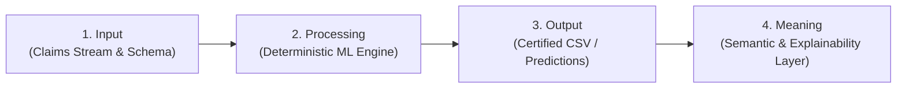

# NEURON5 Pipeline Architecture Vision

> **Architectural Progression Formula:**  
> `Input > Processing > Output > Meaning`

---

## 1. Architectural Overview & Objective

This document formalizes the 4-phase architectural vision of **NEURON5**:  
Moving from deterministic processing of temporal proposition claims to delivering high-level **Semantic Meaning** on top of classified outputs.

---

## 2. The Four Evolution Phases

### Phase 1: Input (Ingestion & Schema Normalization)
- **Scope**: Ingest temporal proposition datasets and claims streams.
- **Components**:
  - `ISO Date Parser`: Robust normalization of calendar timestamps and historical/future date ranges (`YYYY-MM-DD`).
  - `Header & Unicode Normalization`: Sanitization of claim text and identifier alignment (`id`, `text`, `date`).
  - `Map Schema`: Enforcing required relational invariants before runtime execution.

---

### Phase 2: Processing (Deterministic Feature Engine & Model Inference)
- **Scope**: High-throughput signal extraction and model scoring.
- **Components**:
  - `Feature Extraction (Parallel)`:
    - TF-IDF N-Grams (word & char 1,2).
    - Lexicon Entity extraction (entities & relations).
    - Temporal Deltas (date sin/cos cyclical encodings).
  - `Model Inference`: 3-class LightGBM engine scoring proposition probabilities.
  - `Threshold Margin Policy`: Margin threshold evaluation ($\tau = 0.50$) producing ruling outcomes (`true`, `false`, `unsure`).
  - `Table Validation & Audit`: Invariants checking, row count reconciliation, and atomic publishing with telemetry logs (`audit-metrics.json`).

---

### Phase 3: Output (Raw Artifacts & Certified CSV)
- **Scope**: Generating certified, deterministic result artifacts.
- **Components**:
  - `result.csv`: RFC-4180 compliant CSV export containing claim IDs, normalized texts, timestamps, predicted truth labels, and confidence metrics.
  - Verification & analytics console metrics.

---

### Phase 4: Meaning (The Semantic & Explainability Layer — *Future Phase*)
- **Objective**: **Add semantic depth and cognitive interpretability to raw model outputs.**
- **Key Capabilities to Implement**:
  1. **Temporal Grounding & Causal Explainability**:
     - Explain *why* a proposition is evaluated as `true`, `false`, or `unsure` relative to the timeline.
     - Cite exact historical timestamps, conflicting intervals, and reference events that invalidated or verified the claim.
  2. **Knowledge Graph Lineage**:
     - Map outputs back to graph sub-networks, showing entity connections, precedence relationships, and temporal anchors.
  3. **Executive Narrative Synthesis**:
     - Translate classification probabilities into natural-language summaries for auditors, domain experts, and multi-agent decision systems.
  4. **Actionable Recommendations**:
     - Provide confidence bounds and risk-weighted recommendations when claims fall into the `unsure` margin.

---

## 3. Team Reference Note

Whenever building downstream features or post-processing modules, consult this progression:
Ensure that after generating `Output`, the system continues to synthesize and attach `Meaning` to the final delivered intelligence.

