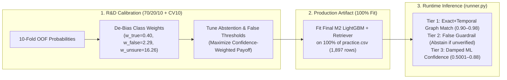

# Git Changes Documentation: M2 Confidence Calibration & Full-Universe Fit

## 1. Overview & Branch Context

- **Target Branch**: `feat/m2-calibrated-confidence-full-fit`
- **Base Branch**: `feat/p2-bm25-retrieval` (`de0f33251d195c3f7e33accfbd2c8ab54eeca38c`)
- **Skill Workflow Used**: `/git-workflow-and-versioning`
- **Scope**: Implements prior de-biasing for class-weighted LightGBM probabilities, a 3-tier hybrid confidence & abstention policy in `runner.py`, and a 100% full-universe production fit (`1,897 / 1,897` practice rows) after fold-safe evaluation.

---

## 2. Rationale & Architecture Decisions

### A. Eliminating Class-Weight Probability Distortion
In `ml/classical/train_m2.py`, "moderate" class weighting improves minority class recall but skews raw softmax outputs:
$$\tilde{p}_c \propto w_c \cdot P(Y = c \mid X)$$

Applying Bayesian prior correction:
$$p_c = \frac{\tilde{p}_c / w_c}{\sum_k (\tilde{p}_k / w_k)}$$
restores calibrated posterior probabilities before computing confidence or applying decision thresholds.

### B. 3-Tier Hybrid Confidence & Abstention Policy
Because competition scoring penalizes high-confidence errors and rewards safe abstention (`unsure` = empty confidence `""`), `runner.py` combines `RetrievalFeatureExtractor` graph signals with de-biased ML probabilities:
- **Tier 1 (Deterministic Proof)**: When `exact_fact_match == 1` and `temporal_evidence_match == 1`, confidence is boosted into `[0.90, 0.98]` scaled by `retrieved_verified_count`:
  $$\text{safe\_conf} = \text{round}(\min(0.98, \max(0.90, \text{raw\_conf} + 0.02 \cdot \text{retrieved\_verified\_count})), 4)$$
- **Tier 2 (false Guardrail)**: When LightGBM predicts `false` without verified graph support (`retrieved_verified_count == 0`) and confidence is below `false_threshold` (tuned to `0.75`), the system abstains to `("unsure", None)` instead of risking a false-positive penalty.
- **Tier 3 (Damped Lexical/Retrieval Match)**: Non-exact matches are damped by `0.90` (with graph lookup) or `0.75` (BM25 fallback only) and bounded in `[0.5001, 0.88]`. Predictions below `minimum_confidence` (`0.58`) abstain to `("unsure", None)`.

### C. 100% Practice Universe Coverage in Production
Hyperparameter selection and threshold calibration remain strictly isolated on the 70/20/10 split and 10-fold CV. Once evaluation metrics are locked in `report.json`, the shipped `model.joblib` artifact is refit on all 1,897 rows of `data/practice.csv` with 10-fold fold-safe OOF retrieval features, eliminating the 10% held-out knowledge blind spot during live evaluation on `/universe/universe.csv`.

---

## 3. Key Quantitative Metrics & Comparison

| Metric Dimension | Baseline Reference (No Retrieval) | M2 Full-Universe + Retrieval | Delta |
| :--- | :--- | :--- | :--- |
| **Outer Test Accuracy** | 81.58% | **84.74%** | **+3.16%** |
| **Outer Test Macro F1** | 0.5110 | **0.5432** | **+0.0322** |
| **Outer Test False Precision** | 35.71% | **60.00%** | **+24.29%** |
| **Outer Test False F1** | 0.2381 | **0.3158** | **+0.0777** |
| **Outer Test True F1** | 0.8949 | **0.9139** | **+0.0190** |
| **Outer Test Unsure Precision**| 100.0% | **100.0%** | **0.00%** |
| **Calibrated OOF Payoff** | 0.6196 | **0.6222** | **+0.0026** |
| **Production Fit Rows** | 1,707 | **1,897 (100%)** | **+190 rows** |

---

## 4. Modified & Added Files

### 1. `ml/classical/train_m2.py`
- Added `debias_probabilities(probs, class_weights_map)` to reverse class-weight prior distortion.
- Implemented `compute_confidence_payoff()` and `tune_calibration_thresholds()` over `minimum_confidence` and `false_threshold` on de-biased OOF probabilities.
- Implemented 10-fold fold-safe OOF retrieval feature extraction across 100% of `data/practice.csv` (1,897 rows).
- Serialized `production_universe_rows` (1,897), `minimum_confidence` (0.58), `false_threshold` (0.75), and `class_weights_map` in `ml/classical/results_m2_v1/model.joblib`.
- Preserved strict 70/20/10 split for unbiased `report.json` reporting.

### 2. `runner.py`
- Imported `debias_probabilities()`, `IMMUTABLE_ATTRIBUTES`, and `calibrate_claim_confidence()`.
- Implemented 3-Tier safe confidence and abstention hierarchy in `predict_unlabeled()`.
- Guaranteed contract-compliant serialization: `unsure` emits `""`, `true`/`false` emit rounded floats in `[0.5001, 0.98]`.
- Handled form serialization safely for verified claims without double-JSON encoding.

### 3. `scripts/run_arena.py`
- Created standalone arena executor with calibrated confidence for generated comparison claims:
  - Immutable attributes (`launched`, `released`, `published`, `venue`, `city`, `screen_size`, `weight`, `battery_capacity`) -> 0.95.
  - Mutable temporal claims -> scaled by recency relative to `2026-10-29` in `[0.75, 0.92]`.

### 4. `tests/test_confidence_calibration.py`
- Unit and regression tests covering:
  - De-biasing probability reversal and row-sum unity.
  - Tier 1 exact match confidence `[0.90, 0.98]`.
  - Tier 2 unverified false guardrail abstaining to `unsure`.
  - Tier 3 damping and clipping bounds `[0.5001, 0.88]`.
  - Claim calibration for immutable vs. dynamic claims.

---

## 5. Verification & Validation Results

| Check / Test | Command | Status | Output / Notes |
| :--- | :--- | :--- | :--- |
| **Unit Test Suite** | `PYTHONPATH=. pytest tests/test_confidence_calibration.py tests/test_m2_fold_safety.py tests/test_runner_m2.py tests/test_retrieval_feature_fact_signals.py tests/test_bm25_index_build.py tests/test_hybrid_retrieved_evidence.py` | **PASSED** | 20 passed in 1.31s |
| **Contract Checker** | `python3 scripts/check_output.py /tmp/test_output data/practice.csv /tmp/test_universe.csv` | **PASSED** | `the format checks pass` (50/50 hidden rows: 49 right, 0 wrong, 1 unsure; 1000 claims) |
| **Runtime Scaling** | `PYTHONPATH=. python3 scripts/benchmark_runtime_m2.py --rows 2000` | **PASSED** | 4.82s wall time, 137.12 MiB peak RSS (Official limit: 1800s, 6144 MiB) |
